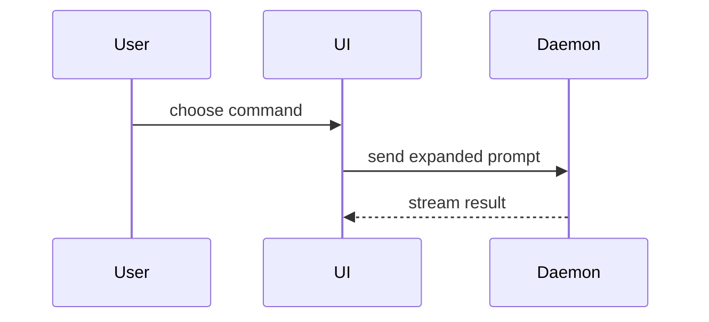

用以下模板撰写 PR 正文：

```markdown
## Summary

<图示、diff 草图或目录树>

## Evidence

- **Before:** <截图/输出/失败的测试运行>
  **After:** <截图/输出/通过的测试运行>

## Merge Danger

**Door:** <单向门或双向门>

<可选：说明>

**Blast Radius:** <一个词的描述>

<可选：合并的潜在影响>
```

## 分节说明

跳过一切前言，行文简短。使用 `CONTEXT.md` 中用户的领域语言。

**读者不只有一个。** 人读 Summary 判断该不该合，后续 agent 读它重建上下文。落笔前过四问——谁改的（范围）、改了什么、怎么验的、什么情况下不该合；四项缺哪项写「待确认：<缺什么>」，不写成含糊的默认。Evidence 只写自己跑过的命令与输出，没跑的不写。

### Summary

选取能让要点最清晰的最小视图。

- 逻辑或算法用伪代码展示：

```text
on(save)
  if content is unchanged
    return cached result
  write new content
  return fresh result
```

- 运行时控制流用调用树展示：

```text
submitForm
  createSession
    persistPrompt
    launchAgent
  navigateToSession
```

- UI 结构用组件树展示，标出重要的状态与模块边界：

```tsx
<SessionPage>(apps / example / src / routes / session.tsx);
useSessionEvents() < SessionToolbar > <RunSkillButton>(packages / ui);
```

- 文件职责或大范围重构用浅层文件树展示：

```text
src/
├── commands/       # 解析用户操作
├── sessions/       # 持有会话状态
└── transport/      # 发送 API 请求
```

- 组件交互、控制流或数据流用 Mermaid 展示：



- 当重点就是"改了什么"且周围结构已经存在时，用 `diff`。diff 的形态要匹配主题。

组件变更：

```diff
 <SessionPage>
   useSessionEvents()
   <SessionToolbar>
+    <RunSkillButton />
   <SessionTimeline>
+    <SkillResultCard />
```

文件布局变更：

```diff
 src/
 ├── commands/
+│   └── show-me.ts       # 展开斜杠命令
 ├── sessions/
-└── transport.ts
+└── transport/
+    ├── client.ts
+    └── stream.ts
```

调用树或调用栈变更：

```diff
 submitForm
   createSession
     persistPrompt
+    expandSkillMention
     launchAgent
-  navigateToSession
+  navigateToSession
+    subscribeToEvents
```

状态或控制流变更：

```diff
 on(save)
-  write content
+  if content is unchanged
+    return cached result
+  write content
+  invalidate cache
```

- 当大部分内容都是新的、省略上下文会掩盖所有权或顺序、或用户需要一个可复制的目标形态时，展示整个代码块：

```ts
function expandSkill(command: string): string {
  const skillName = command.slice(1);
  return `use the ${skillName} skill`;
}
```

#### 准则

每张图放在它所支撑的短文本旁边。只保留能回答用户当前问题、或能给出当前讨论点可选解法的调用、文件、props、状态与边界。

可以只用其中一种，也可以混用几种，但不太可能全用上。自行判断，不要让用户被淹没。

### Evidence

证明变更确实生效的具体证据。展示前后对照。

环境就绪且变更可视时，截图是 S 级证据。

执行类证据是 A 级：测试结果、控制台输出。用伪代码展示现在失败、之后通过的那条具体测试。

### Merge Danger

说明这是单向门还是双向门。双向门可以走回去，单向门不能。容易回滚的 PR 风险更低。涉及破坏性操作或难以逆转的决策的变更属于单向门。

爆炸半径（blast radius）是本次 PR 引入变更的潜在影响或波及范围。把所有可能性都考虑到，例如布局位移、对使用方造成的破坏、移动端响应性等。
